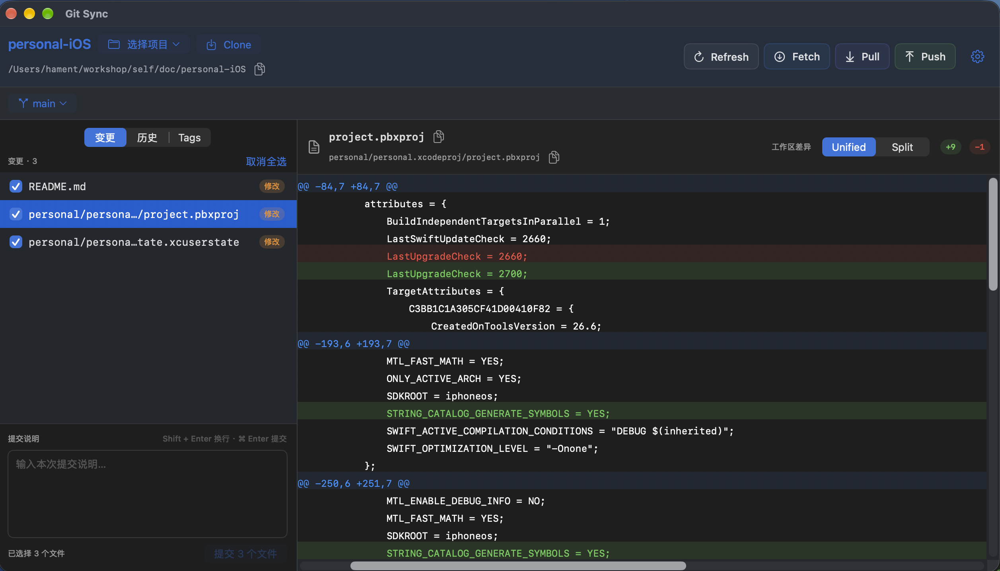
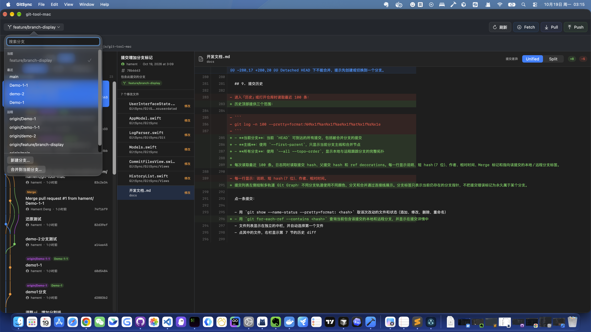
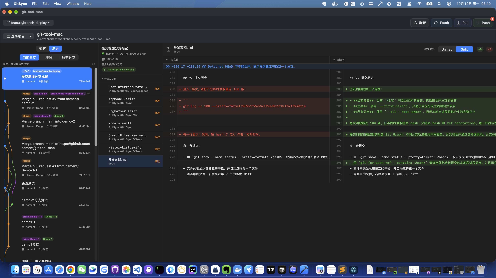
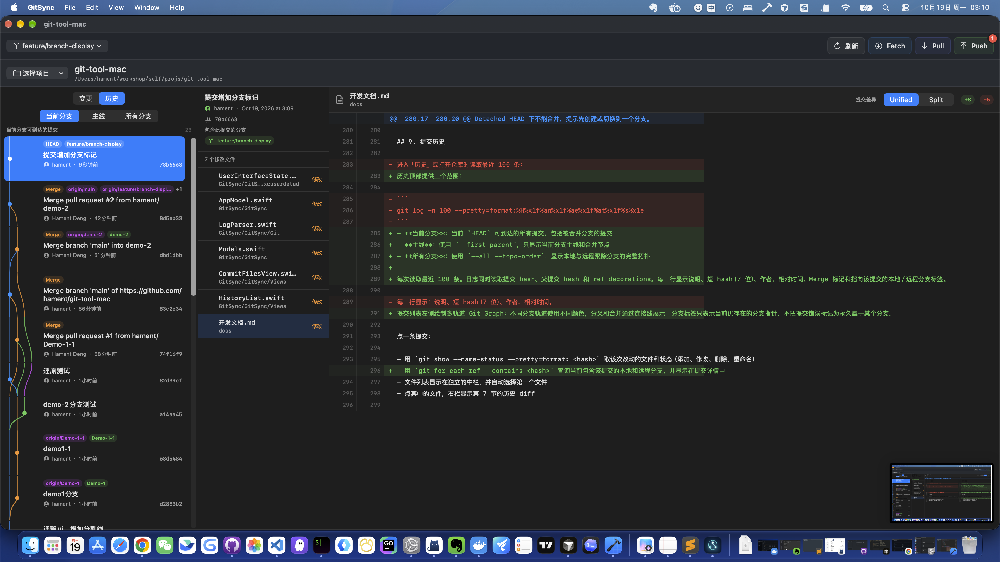

# GitSync

[English](README.en.md) | [中文](README.md)

A native Git app for Mac, written in Swift. Open a local repository to review file changes, manage branches, browse commit history, and Fetch, Pull, or Push.

## Features

### File changes

Check the files to commit, compare the diff on the right, and write the message at the bottom before committing.



### Branches

Search and switch local or remote branches, create a new branch, or merge another branch into the current one.



### Commit history

View the commit graph for the current branch, the main line, or all branches. Select a commit to list its changed files, then compare them in Split or Unified mode.





## Run

With Xcode installed, you can build and launch from the repository root without opening the Xcode window:

```bash
xcodebuild \
  -project GitSync/GitSync.xcodeproj \
  -scheme GitSync \
  -destination 'platform=macOS' \
  -configuration Debug \
  -derivedDataPath .build \
  build

open .build/Build/Products/Debug/GitSync.app
```

The first build creates the compiler cache and takes longer. After that, repeat the two commands above.

Quit a running copy before opening it again, or the previous process may stay open. After changing the code, rebuild first. Running `open` alone launches the last built app.

## Build only

```bash
xcodebuild \
  -project GitSync/GitSync.xcodeproj \
  -scheme GitSync \
  -destination 'platform=macOS' \
  -configuration Debug \
  -derivedDataPath .build \
  build
```

The app is written to `.build/Build/Products/Debug/GitSync.app`. That directory is only for local builds and does not need to be committed.
