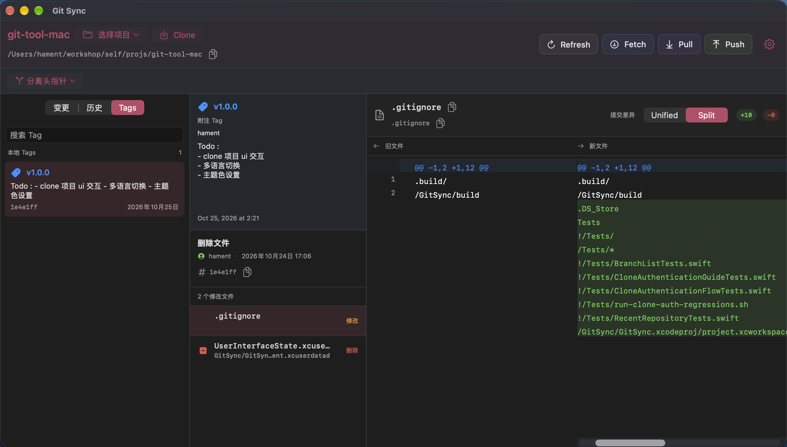

# GitSync

[English](README.en.md) | 中文

Mac 原生的Git可视化App，用 Swift 开发，保持轻量,极致性能。打开本机仓库后，可以查看文件变更、浏览提交历史和 Tag，并完成日常的远程同步。如果你已经厌倦了github desktop 臃肿和响应缓慢, 可以尝试这个App!

## 特色功能

- **基本操作**：克隆仓库，以及对当前仓库执行 Fetch、Pull、Push。
- **分支**：搜索本地和远程分支，任意两个分支可以放在一起对比，也可以把其他分支合并到当前分支。
- **多窗口**：每个窗口对应一个项目，可以同时管理多个不同仓库。
- **主题色**：不同项目可以各自设置主题色。
- **多语言**：界面支持简体中文和 English。
- **响应迅速**：即使加载多达上万个分支,分支列表依然可以秒级展示,无论内存占用还是响应速度,都大大优于github desktop的表现。

## 界面

下面四张图来自不同项目窗口，主题色也各不相同。

### 文件变更

在「变更」里勾选要提交的文件，右侧用 Unified 或 Split 查看工作区差异，底部写好说明后提交。顶部可以切换项目、克隆仓库，以及 Refresh、Fetch、Pull、Push。


### 提交历史

切到「历史」，按当前分支、主线或所有分支查看提交。选中一条后，中间是说明和改动文件，右侧对照这次提交的差异。第一张是 Unified，第二张是 Split，左右分栏显示旧文件和新文件。


### Tags


在「Tags」里搜索本地 Tag。选中后可以看到附注、对应提交和改动文件，右侧继续用 Unified 或 Split 对照内容。




## 编译

本机已安装 Xcode 后，不需要打开 Xcode 窗口，在仓库根目录执行：

```bash
xcodebuild \
  -project GitSync/GitSync.xcodeproj \
  -scheme GitSync \
  -destination 'platform=macOS' \
  -configuration Debug \
  -derivedDataPath .build \
  build

```

第一次编译会下载或生成编译缓存，时间会长一些。


## 运行

```bash
open .build/Build/Products/Debug/GitSync.app
```

编译结果在 `.build/Build/Products/Debug/GitSync.app`。这个目录只用于本地编译，不需要提交。

应用已经在运行时，先退出再重新 `open`，否则可能仍是上一次的进程。修改代码后需要重新编译，只执行 `open` 会启动上一次编出来的应用。
